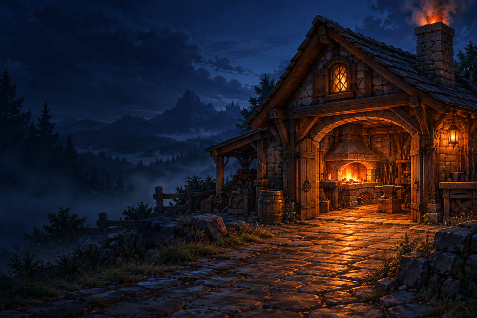
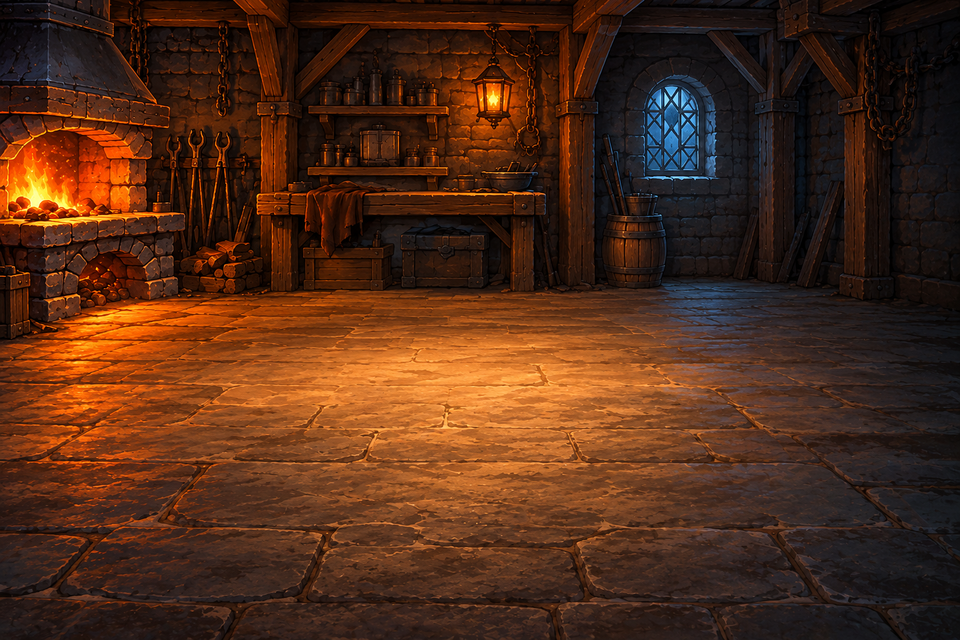
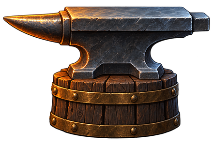
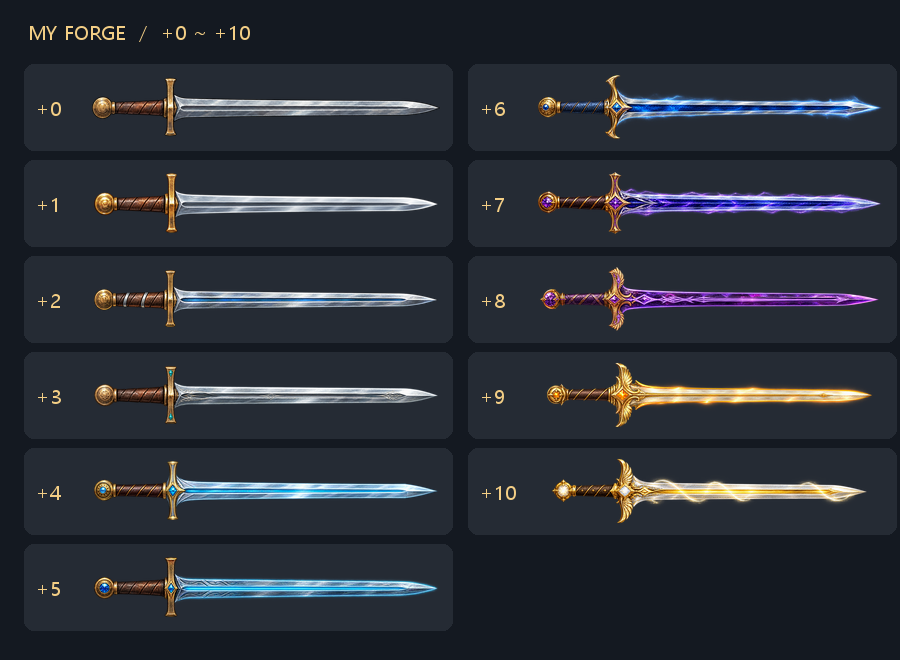
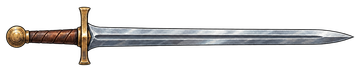
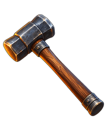
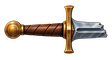
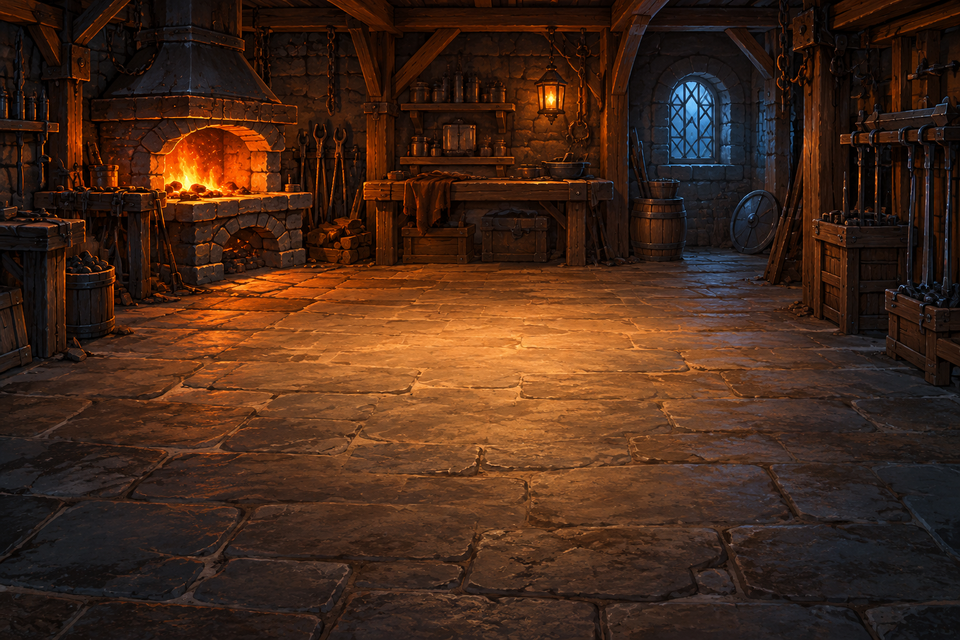

# Game "My Forge" (무기 강화 게임)
- 작성자: 김기현
- 조작법: 마우스 왼쪽 버튼

## 1. 게임 개요
정해진 횟수 안에서 무기를 강화하며 최고 강화 단계에 도전하는 간단한 확률형 강화 시뮬레이션 게임이다.

## 2. 게임 목표
제한된 강화 시도 횟수 안에서 최대한 높은 강화 단계에 도달하는 것이 목표이다. 최고 단계는 +10이며, 이번 판에서 도달한 가장 높은 단계를 기록으로 남긴다.

## 3. 핵심 규칙
- 무기는 +0부터 시작하며, +10까지 강화할 수 있다.
- 한 판에서 강화를 시도할 수 있는 횟수는 30회이다. 최대 횟수는 추후 조정할 수 있다.
- 강화 시, 현재 단계에 정해진 확률에 따라 성공, 실패, 파괴 중 하나의 결과가 발생한다.
- 성공할 시, 강화 단계가 한 단계 상승한다.
- +0부터 +4까지는 실패해도 현재 단계가 유지된다.
- +5 이상에서 실패할 시, 강화 단계가 한 단계 하락한다.
- 파괴될 시, 새로운 +0 무기로 남은 횟수만큼 강화를 계속한다.
- 강화 결과와 관계없이 시도 횟수는 1회씩 소모된다.
- 단계가 하락하거나 무기가 파괴되어도 이번 판의 최고 기록은 유지된다.
- 시도 횟수를 모두 사용하거나 +10에 도달하면 게임이 종료된다.

## 4. 게임 진행
게임이 시작되면 +0 무기와 강화 시도 횟수가 주어진다.

플레이어가 망치 모양의 강화 버튼을 누르면 망치가 3번 두드려진 뒤 결과를 확인한다. 결과에 따라 무기의 단계가 바뀌며, 남은 횟수 안에서 강화를 반복한다.

게임이 종료되면 이번 판의 최고 강화 단계를 확인하고 다시 도전할 수 있다.

## 5. 조작 방법
- 게임 시작 버튼 클릭 [마우스 왼쪽 버튼]
- 망치에 마우스를 올리면 망치가 커진다.
- 망치 모양의 강화 버튼 클릭 [마우스 왼쪽 버튼]
- 게임 시작 [Enter] / 시작 화면으로 돌아가기 [Esc]
- 다시 도전 버튼 클릭 [마우스 왼쪽 버튼 / 추후 구현]

## 6. 주요 객체
- 강화 대상인 무기
- 강화 연출에 사용되는 망치와 모루
- 게임 시작 버튼, 망치 모양의 강화 버튼, 다시 도전 버튼
- 현재 강화 단계, 남은 시도 횟수, 단계별 확률, 최고 기록 표시

## 7. 구현 범위

### 전체 구현 계획

- 게임 시작 화면, 강화 화면, 결과 화면을 구성한다.
- +0부터 +10까지의 강화 판정과 시도 횟수, 최고 기록을 구현한다.
- 망치가 움직이는 강화 애니메이션과 성공, 실패, 파괴에 따른 효과를 표현한다.
- 결과 확인 이후 다시 도전하는 기능을 구현한다.

### 3차 제출 구현

- 시작 화면과 메인 게임 화면의 배경, 검, 모루, 망치를 출력한다.
- 망치에 마우스를 올리면 15% 커지며, 클릭하면 3번 두드리는 연출과 효과음이 나온다.
- 두드리는 중에는 다시 클릭할 수 없으며, 연출이 끝나면 다시 누를 수 있다.
- 메인 게임 화면에서는 불과 풀무 소리를 조합한 대장간 배경 사운드를 반복 재생한다.
- 시작 화면으로 돌아가거나 다른 창으로 이동하면 연출과 사운드가 멈춘다. 메인 게임 창으로 돌아오면 배경 사운드가 다시 나온다.
- +0부터 +10까지 검 이미지를 준비한다. 현재 화면에는 +0 검을 출력한다.
- 이번 제출은 기본 조작과 렌더링, 사운드 출력까지 구현한다. 강화 판정, 단계 변화, 시도 횟수 차감, 결과 화면은 이후에 구현한다.
- 캐릭터의 키보드 이동은 구현 범위에서 제외한다.

## 8. 필요 리소스

### 이미지

- 게임 시작 화면 배경 이미지 (960×640)
- 메인 게임 화면 배경 이미지 (960×640)
- 모루 이미지 (440×300)
- +0 검 이미지 (360×72 / [sword_00.png](../resource/images/swords/sword_00.png))
- +1 검 이미지 (360×72 / [sword_01.png](../resource/images/swords/sword_01.png))
- +2 검 이미지 (360×72 / [sword_02.png](../resource/images/swords/sword_02.png))
- +3 검 이미지 (360×72 / [sword_03.png](../resource/images/swords/sword_03.png))
- +4 검 이미지 (360×72 / [sword_04.png](../resource/images/swords/sword_04.png))
- +5 검 이미지 (360×72 / [sword_05.png](../resource/images/swords/sword_05.png))
- +6 검 이미지 (360×72 / [sword_06.png](../resource/images/swords/sword_06.png))
- +7 검 이미지 (360×72 / [sword_07.png](../resource/images/swords/sword_07.png))
- +8 검 이미지 (360×72 / [sword_08.png](../resource/images/swords/sword_08.png))
- +9 검 이미지 (360×72 / [sword_09.png](../resource/images/swords/sword_09.png))
- +10 검 이미지 (360×72 / [sword_10.png](../resource/images/swords/sword_10.png))
- 기본 검 원본 이미지 (360×72 / 보관용)
- 망치 이미지 (180×220)
- 파괴된 검의 손잡이 이미지 (112×60 / 파괴 연출용)
- 파괴된 검의 중간 칼날 이미지 (104×28 / 파괴 연출용)
- 파괴된 검의 끝부분 이미지 (112×28 / 파괴 연출용)
- 초기 대장간 배경 이미지 (960×640 / 보관용)

파괴된 검 이미지는 이후 연출에 사용하며, 초기 대장간 배경은 보관용으로 남겨둔다.

### 사운드

- 대장간 배경 사운드 ([forge_ambience.wav](../resource/audio/forge_ambience.wav) / 24초 반복 재생)
- 씬 전환 효과음 ([scene_transition.wav](../resource/audio/scene_transition.wav) / pause.wav 사용)
- 강화 시도 효과음 ([attempt_three_hits.wav](../resource/audio/attempt_three_hits.wav) / 세 번째 효과음을 3번 재생)
- 강화 성공 효과음 ([success.wav](../resource/audio/success.wav) / 01_parry.wav 직후 relic_aquired.wav를 1.5배속으로 재생)
- 강화 실패 효과음 ([failure.wav](../resource/audio/failure.wav) / Torch Attack Strike 2.ogg 사용)

효과음의 음량을 같은 기준으로 맞추고, 게임의 효과음 재생 음량은 70%로 설정한다.

시작 화면과 메인 게임 화면을 오갈 때 씬 전환 효과음을 사용한다. 메인 화면에서는 대장간 배경 사운드가 반복 재생되며, 망치를 클릭하면 3회 타격음이 나온다. 성공과 실패 효과음은 이후 강화 판정 구현 시 사용하도록 보관한다.

강화 시도 효과음은 타격음이 끝난 뒤 0.35초씩 뜸을 들여 총 3번 들리도록 준비하였다. 성공 효과음은 두 소리가 순서대로 이어지도록 준비하였으며, 보상음의 1.5배속이 이미 적용되어 있다.

원본은 `../resource/audio/originals`에 보관한다. 개별 가공 파일인 `hammer_hit.wav`, `success_impact.wav`, `success_reward.wav`도 `../resource/audio`에 함께 보관한다. 효과음은 약 -20 LUFS로 맞추었으며, 배경 사운드는 효과음보다 작게 들리도록 약 -30 LUFS로 제작하였다. 70% 음량은 게임에서 한 번 적용한다.

## 9. 리소스 이미지

### 게임 시작 화면 배경

### 메인 게임 화면 배경

### 모루

### 단계별 검

낮은 단계는 금속의 광택과 장식이 바뀌고, 높은 단계는 푸른빛, 보랏빛, 금빛으로 구분한다. 개별 파일은 `images/swords`에 단계별로 정리한다.

### 기본 검 원본

### 망치

### 파괴된 검의 손잡이

### 파괴된 검의 중간 칼날

### 파괴된 검의 끝부분

### 초기 대장간 배경

