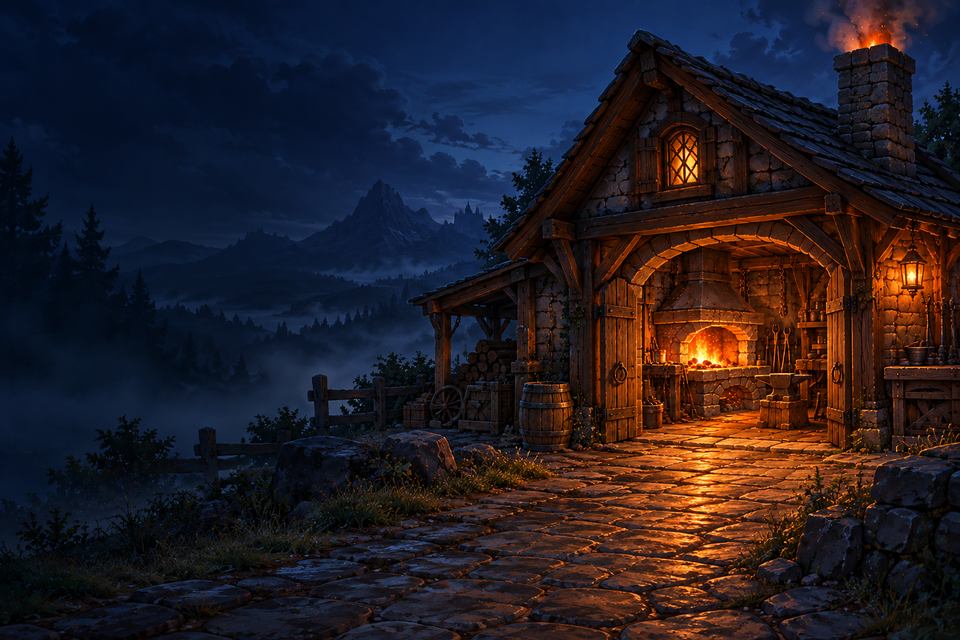
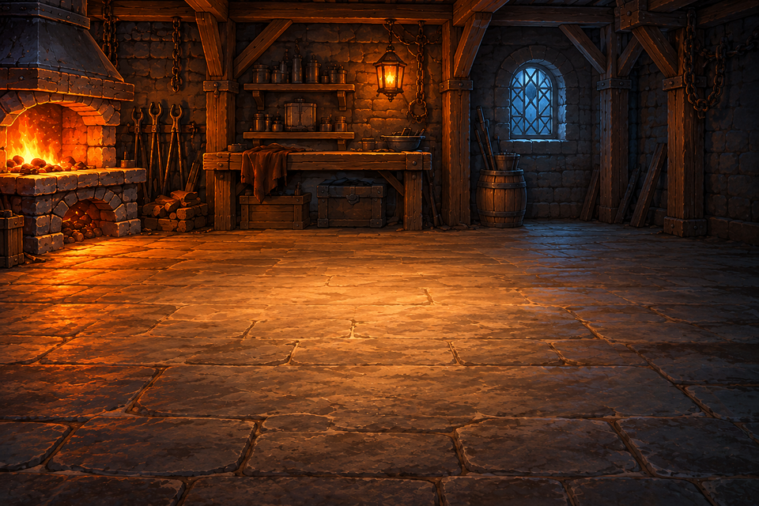
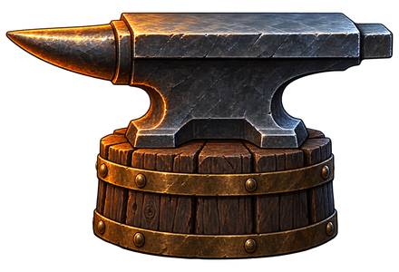
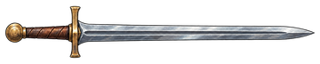
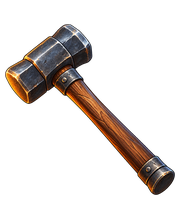
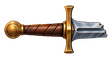
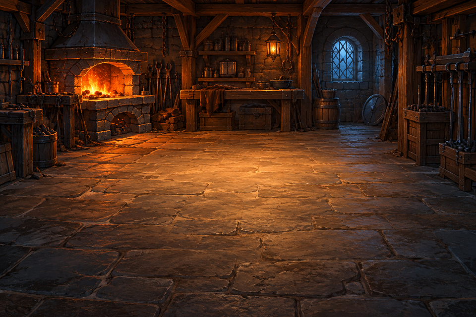

# Game Resource

## 필요 리소스

### 이미지

- 게임 시작 화면 배경 이미지 (960×640)
- 메인 게임 화면 배경 이미지 (960×640)
- 모루 이미지 (440×300)
- 기본 검 이미지 (360×72)
- 망치 이미지 (180×220)
- 파괴된 검의 손잡이 이미지 (112×60 / 파괴 연출용)
- 파괴된 검의 중간 칼날 이미지 (104×28 / 파괴 연출용)
- 파괴된 검의 끝부분 이미지 (112×28 / 파괴 연출용)
- 초기 대장간 배경 이미지 (960×640 / 보관용)

파괴된 검 이미지는 이후 연출에 사용하며, 초기 대장간 배경은 보관용으로 남겨둔다.

## 리소스 이미지

### 게임 시작 화면 배경

### 메인 게임 화면 배경

### 모루

### 기본 검

### 망치

### 파괴된 검의 손잡이

### 파괴된 검의 중간 칼날

### 파괴된 검의 끝부분

### 초기 대장간 배경

## 출처 및 이용 조건

- OpenAI imagegen으로 본 프로젝트용 이미지를 생성하였다.
- 생성한 대장간 배경과 기본 검을 나머지 이미지의 참고 자료로 사용하였다.
- 외부 게임에서 추출한 이미지나 다운로드한 이미지 팩은 사용하지 않았다.
- 이용 조건은 생성에 사용한 OpenAI 서비스의 적용 약관을 따른다. 별도의 CC 또는 퍼블릭 도메인 표시는 하지 않는다.
- [이미지 생성 프롬프트](image_prompts.md)

## 적용 범위

- 시작 씬과 메인 게임 씬에서 서로 다른 배경을 출력한다.
- 시작 화면의 게임 시작 버튼 또는 Enter로 메인 게임 화면에 진입한다.
- 메인 화면의 시작 화면 버튼 또는 Esc로 시작 화면에 돌아온다.
- 시작 화면의 종료 버튼으로 프로그램을 종료한다.
- 현재 단계, 남은 시도, 최고 기록은 초기값을 표시하며, 확률은 미정 표시로 둔다.
- 강화 버튼은 비활성 상태이다. 강화 판정, 단계 변화, 애니메이션 및 사운드는 구현하지 않았다.
- 파괴 조각 이미지는 이후 연출용으로 보관하며, 메인 UI에서는 출력하지 않는다.
- UI의 글자와 패널, 버튼은 프로그램에서 그린다.
