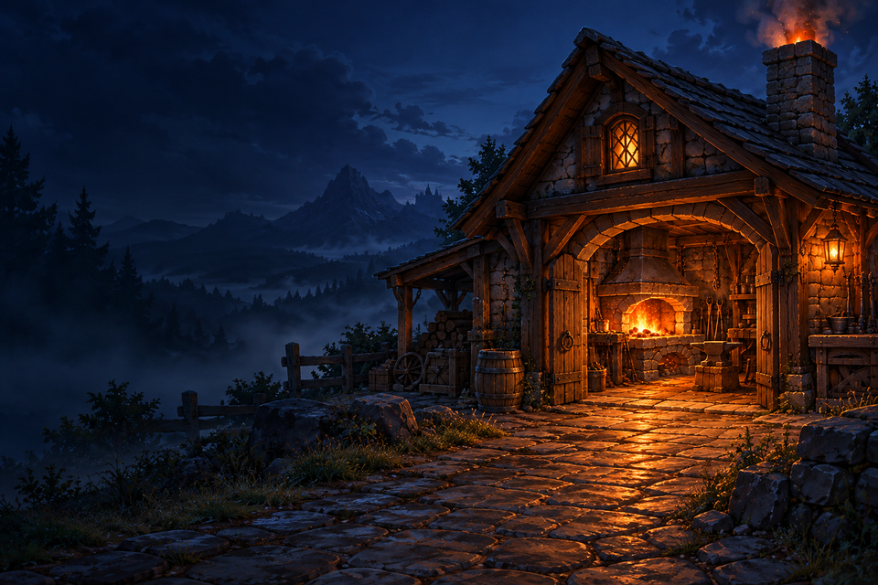
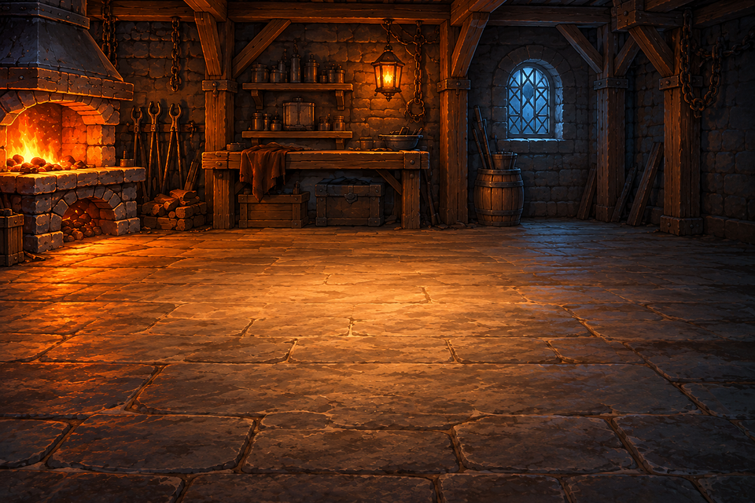
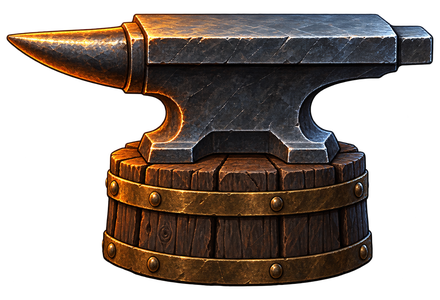
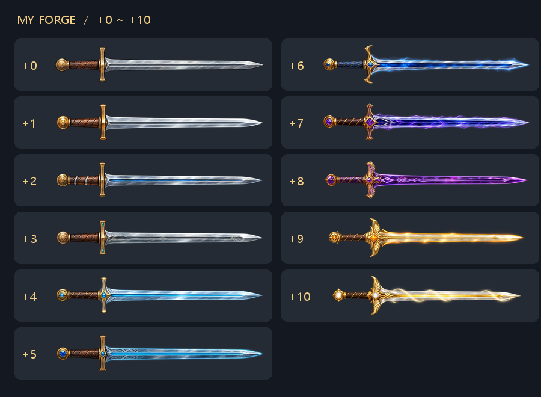
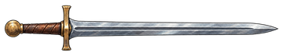
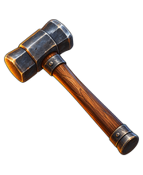
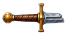
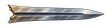
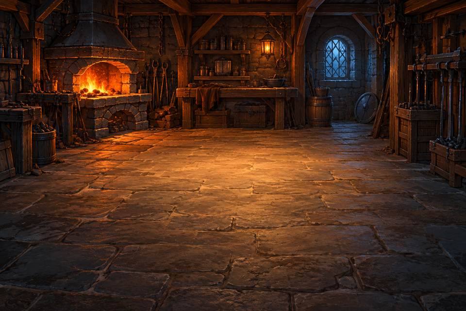

# Game Resource

## 필요 리소스

### 이미지

- 게임 시작 화면 배경 이미지 (960×640)
- 메인 게임 화면 배경 이미지 (960×640)
- 모루 이미지 (440×300)
- +0 검 이미지 (360×72 / [sword_00.png](images/swords/sword_00.png))
- +1 검 이미지 (360×72 / [sword_01.png](images/swords/sword_01.png))
- +2 검 이미지 (360×72 / [sword_02.png](images/swords/sword_02.png))
- +3 검 이미지 (360×72 / [sword_03.png](images/swords/sword_03.png))
- +4 검 이미지 (360×72 / [sword_04.png](images/swords/sword_04.png))
- +5 검 이미지 (360×72 / [sword_05.png](images/swords/sword_05.png))
- +6 검 이미지 (360×72 / [sword_06.png](images/swords/sword_06.png))
- +7 검 이미지 (360×72 / [sword_07.png](images/swords/sword_07.png))
- +8 검 이미지 (360×72 / [sword_08.png](images/swords/sword_08.png))
- +9 검 이미지 (360×72 / [sword_09.png](images/swords/sword_09.png))
- +10 검 이미지 (360×72 / [sword_10.png](images/swords/sword_10.png))
- 기본 검 원본 이미지 (360×72 / 보관용)
- 망치 이미지 (180×220)
- 파괴된 검의 손잡이 이미지 (112×60 / 파괴 연출용)
- 파괴된 검의 중간 칼날 이미지 (104×28 / 파괴 연출용)
- 파괴된 검의 끝부분 이미지 (112×28 / 파괴 연출용)
- 초기 대장간 배경 이미지 (960×640 / 보관용)

파괴된 검 이미지는 파괴 연출에 사용하며, 초기 대장간 배경은 보관용으로 남겨둔다.

### 사운드

- 대장간 배경 사운드 ([forge_ambience.wav](audio/forge_ambience.wav) / 24초 반복 재생)
- 씬 전환 효과음 ([scene_transition.wav](audio/scene_transition.wav) / pause.wav 사용)
- 강화 시도 효과음 ([attempt_three_hits.wav](audio/attempt_three_hits.wav) / 세 번째 효과음을 3번 재생)
- 강화 성공 효과음 ([success.wav](audio/success.wav) / 01_parry.wav 직후 relic_aquired.wav를 1.5배속으로 재생)
- 강화 실패 효과음 ([failure.wav](audio/failure.wav) / Torch Attack Strike 2.ogg 사용)

효과음의 음량을 같은 기준으로 맞추고, 게임의 효과음 재생 음량은 70%로 설정한다.

시작 화면과 메인 게임 화면을 오갈 때 씬 전환 효과음을 사용한다. 메인 화면에서는 대장간 배경 사운드가 반복 재생되며, 망치를 클릭하면 3회 타격음이 나온다. 성공 시에는 성공 효과음을, 실패와 파괴 시에는 실패 효과음을 재생한다.

강화 시도 효과음은 0.5초 간격으로 3번 들리며, 잔향을 포함한 전체 타격 시간은 2.2초이다. 성공 효과음은 마무리 타격음의 잔향을 끝까지 유지하고, 시작 0.2초 뒤 보상음이 겹쳐 나오도록 준비하였으며, 보상음의 1.5배속이 이미 적용되어 있다.

원본은 `audio/originals`에 보관한다. 개별 가공 파일인 `hammer_hit.wav`, `success_impact.wav`, `success_reward.wav`도 `audio`에 함께 보관한다. 효과음은 약 -20 LUFS로 맞추었으며, 배경 사운드는 효과음보다 작게 들리도록 약 -30 LUFS로 제작하였다. 70% 음량은 게임에서 한 번 적용한다.

## 리소스 이미지

### 게임 시작 화면 배경

### 메인 게임 화면 배경

### 모루

### 단계별 검

낮은 단계는 금속의 광택과 장식이 바뀌고, 높은 단계는 푸른빛, 보랏빛, 금빛으로 구분한다. 개별 파일은 `images/swords`에 단계별로 정리한다.

### 기본 검 원본

### 망치

### 파괴된 검의 손잡이

### 파괴된 검의 중간 칼날

### 파괴된 검의 끝부분

### 초기 대장간 배경

## 출처 및 이용 조건

- OpenAI imagegen으로 본 프로젝트용 이미지를 생성하였다.
- 생성한 대장간 배경과 기본 검을 나머지 이미지의 참고 자료로 사용하였다.
- 외부 게임에서 추출한 이미지나 다운로드한 이미지 팩은 사용하지 않았다.
- 이용 조건은 생성에 사용한 OpenAI 서비스의 적용 약관을 따른다. 별도의 CC 또는 퍼블릭 도메인 표시는 하지 않는다.
- 효과음은 기존 프로젝트에서 제공한 파일을 사용하였다. 원본을 보관하고, 게임에 사용할 파일의 음량과 재생 속도를 조정하였다.

- 단계별 검은 기존 검을 참고하여 OpenAI imagegen으로 각각 생성한 뒤, 투명 배경을 유지해 같은 크기로 맞추었다.
- 대장간 배경 사운드는 외부 음원 없이 불과 풀무를 표현하는 소리를 직접 합성하였다.

## 폴더 구성

- `images` : 배경, 모루, 망치와 기존 이미지
- `images/swords` : +0부터 +10까지 단계별 검 이미지
- `audio` : 게임에서 사용할 WAV 파일
- `audio/originals` : 제공받은 원본 음원
- 검 이미지 모음은 `docs/images/sword_levels.png`에 보관한다.

## 적용 범위

- 시작 화면, 강화 플레이 화면, 한 판의 결과 표시와 재도전을 구현하였다.
- 30회 제한 안에서 +10에 도전한다. 현재 단계, 남은 횟수, 최고 기록, 다음 강화 확률을 갱신한다.
- 망치에 마우스를 올리면 15% 커지며, 클릭하면 3회 타격 이후 검이 흰빛으로 덮이고 커진다.
- 성공 시 다음 단계 검과 금빛 입자를, 실패 시 흔들림을, 파괴 시 흩어지는 검 조각을 출력한다.
- 검 이미지는 실제 강화 단계에 맞춰 +0부터 +10까지 사용한다.
- 흰빛은 검 PNG의 투명도를 사용해 실행 중에 그린다. 금빛 입자도 프로그램에서 그리므로 추가 이미지 파일은 필요하지 않다.
- 씬 전환음, 타격음, 성공음, 실패음, 대장간 배경 사운드를 연결하였다. 파괴 시 실패음을 함께 사용한다.
- 다른 창으로 이동하면 진행과 사운드를 멈추고, 돌아오면 배경음을 재개한다. 타격 중이었다면 타격 연출도 다시 시작한다.
- 원본 음원과 검의 원본 이미지는 보관한다. 배경 사운드 및 단계별 검 폴더 구성은 유지한다.
- 캐릭터 키보드 이동은 구현하지 않는다. UI 글자와 패널, 시작·복귀·재도전 버튼은 프로그램에서 그린다.
